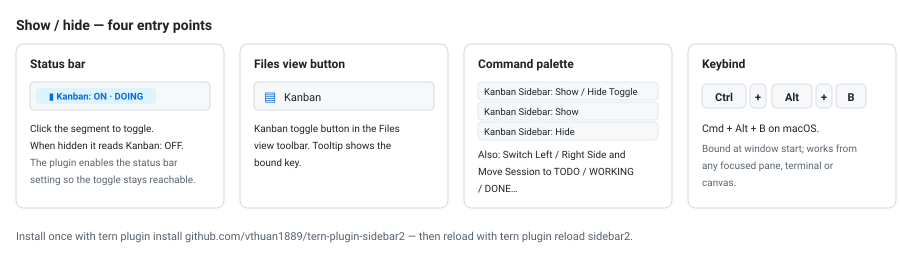
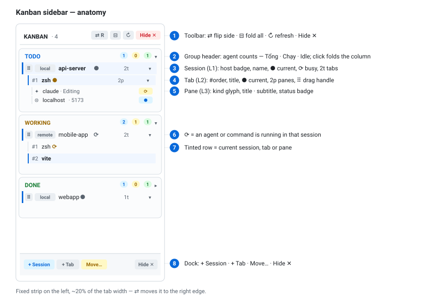
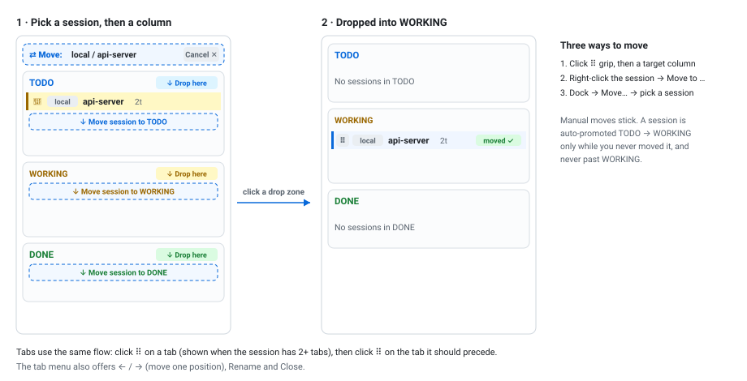

# Sidebar Kanban (`sidebar2`)

A fixed Kanban sidebar for Tern that turns your window layout into a board: every **Host + Session** lives
in one of six columns — **TODO**, **WORKING**, **REVIEW**, **PAUSED**, **STUCK**, **DONE** — and you can
drill into its **tabs** and **panes** from the same strip.

The sidebar is a plugin canvas pinned to the edge of the active tab. It never takes focus, and the rest of
the tab is untouched.

- Six columns, three levels: session → tab → pane.
- Move sessions by grip-and-drop, row menu, or the `Move…` picker.
- Reorder tabs by grip-and-drop.
- Show/hide from the status bar, the Files button, the command palette or `Ctrl+Alt+B`.
- Show/hide any stage column, or every empty one, from the dock's `kanban` icon.
- Layout, column assignment and fold state persist across restarts.

## Install

```sh
tern plugin install github.com/vthuan1889/tern-plugin-sidebar2
# or, while hacking on it:
git clone https://github.com/vthuan1889/tern-plugin-sidebar2 && cd tern-plugin-sidebar2
tern plugin link .
tern plugin reload sidebar2
```

`tern plugin list` shows whether it loaded. Type definitions for `luau-lsp` regenerate with
`tern plugin types .`.

## Show / hide



The toggle is reachable even when the sidebar is hidden. The status-bar segment appears when the
`status_bar` setting is on; the plugin never turns it on for you.

| Entry point | Where |
| --- | --- |
| Status bar | `Kanban: ON · <stage>` / `Kanban: OFF` segment, click to toggle |
| Files view | Kanban icon button in the Files toolbar |
| Command palette | `Kanban Sidebar: Show / Hide Toggle` |
| Keybind | `Ctrl+Alt+B` (`Cmd+Alt+B` on macOS) |

## Anatomy



| Level | Row | Shows | Click |
| --- | --- | --- | --- |
| — | Toolbar | session count, `R`/`L` side flip, fold all, refresh, hide `×` (icon buttons with tooltips) | acts immediately |
| 2 | Group header | `TODO` / `WORKING` / `REVIEW` / `PAUSED` / `STUCK` / `DONE`, agent count badges (`Tổng` / `Chạy` / `Idle`), chevron | folds the column |
| 1 | Session | host badge, session name, `2t` = tab count, `✦` badge | switches to the session |
| 2 | Tab | program icon (the AI agent's when one runs in it, else `terminal`), `#order`, tab title, `2p` = pane count, `✦` badge | focuses the tab |
| 3 | Pane | program icon (the AI agent's for an agent pane), pane title, `·` subtitle, status badge | focuses the pane |

Level 3 appears only for tabs holding **2 or more panes** — single-pane tabs stay compact.
The status badge is a `✦` pill: yellow and blinking while the agent works, green and blinking when a
finished agent is unread, dim once read, and nothing while idle. Hovering a row shows a tooltip with the
session/tab/pane detail.

Row tint plus the accent bar mark the current session, tab and pane. Long names are truncated at 20
characters (sessions) and 24 (tabs).

## Moving sessions between columns



Three equivalent ways, all stored per session:

1. **Grip-and-drop** — click the `⠿` grip on a session row. Every column header turns into
   `↓ Drop here` and each session row of the target column shows `↕ #<position>`. Click a header to move
   the session there, or a row to drop it at that position. Clicking the grip again cancels.
2. **Row menu** — right-click the session row (or its grip): `Move to TODO`, `Move to WORKING`,
   `Move to REVIEW`, `Move to PAUSED`, `Move to STUCK`, `Move to DONE`.
3. **`Move…` in the dock** — a picker listing every session × column, with the current column as detail.

The picked session shows `🎯` instead of `⠿`.

### Dragging with the mouse

Press anywhere on a session row (the fold chevron on its right stays click-only) and drag: the hovered
column takes it, and the row edge it will land on shows an accent line — top edge = before that row,
bottom edge = after it. The last row carries `↕ #<position>` while a drag appends past the end of a
column. Releasing drops the session at that exact slot; dragging inside its own column reorders it in place.

### Auto-promotion

A new session starts in **TODO**. The first time one of its commands or agents starts running, it is
promoted to **WORKING** on its own — but only while you have never moved that session manually. From
the first manual move on, the column is yours and the plugin stops touching it. Nothing is ever moved to
**DONE** automatically.

## Reordering tabs

Click `⠿` on a tab row (the grip appears when the session has **2 or more** tabs) → the tab turns `🎯`
and the header shows `↕ Move Tab: …`. Now click `⠿` on any other tab of the same session: the picked tab
is moved to that position. The tab menu also has `Move Tab Up` / `Move Tab Down` for one step at a time.
Dragging a tab row with the mouse works the same way: the accent line shows the edge it will land on.

## Row menus

| Row | Menu items |
| --- | --- |
| Group header | New session in *this column* · Collapse / Expand column |
| Session | New tab here · New tab omp *(opens `omp` in the session's start folder)* · Focus · Rename · Move to any of the six stages *(radio group, current one checked)* · Pick *(drag)* · Move up / down |
| Tab | New tab · New tab omp *(opens `omp` in that tab's folder)* · Close tab *(danger)* · Focus · Rename · Pick *(2+ tabs)* · Move up / down |
| Pane | Focus · Split right · Split down · Close pane *(danger)* |

`Close tab` closes every non-sidebar pane in that tab. The dock holds two buttons: `Session` asks for a
name — leave it empty for an auto-generated one — and places the session in **TODO**; `Move…` opens the
picker above. Two icon buttons configure what is drawn:

- `kanban` — a row per stage pill (`✓ TODO` … `✓ DONE`) that shows or hides that column, plus
  `Ẩn trống`: hide every column that holds no session. Choices persist.
- `sliders` — four pills (`Tổng` / `Chạy` / `Idle` / `Ẩn 0`) that show or hide the matching agent
  count badge in every column header, and drop any badge reading `0`; the choice persists.

## Agent count badges

Each column header carries three pills counting the **AI agent** panes of the sessions in that column,
folded or not: cyan `Tổng` (all agents), amber `Chạy` (working now), green `Idle` (finished or waiting).
Click the dock's `sliders` icon to toggle any of the three on or off, and `Ẩn 0` to hide a badge whose
value is `0` (a column with no agents then shows its label alone). Its right-click menu carries the same
four switches.

## Placement

The strip is a canvas pane pinned to the left edge of **every** tab at **20%** of its width; switching
tabs or sessions shows the strip already there at that width, so it never resizes. The `R` / `L` toolbar
button moves every strip to the other edge.

A canvas pane lives in the session's daemon, so a **remote host must run a Tern new enough to host
canvases** (0.9.9 or later). An older host reports no error: `canvas:open` hands back a plain pane and
every paint fails with `pane is not a canvas`. The plugin then closes that pane and stops trying on that
host until its Tern version changes, so you get no strip at all rather than a blank one. Fix it with:

```sh
tern remote update <host>   # per remote host, from the window's own Tern version
```

Drag the divider to set the width (8–60% of the tab); the ratio is remembered and every session is sized to
it, so switching sessions never changes how wide the strip is. The pane header is hidden, so the toolbar row
is the sidebar's only head, the way Tern's Settings sheet carries its own; the CSS finds the pane by the
canvas title, so renaming `SIDEBAR_TITLE` means updating that selector too.

## Persistence

State is stored in the plugin's key/value store:

| Key | Contents |
| --- | --- |
| `host::session` | column assignment, keyed by **host name + session name** |
| session key | fold state, manual-move flag |
| `tab id` | fold state |
| — | visibility, side, width ratio, stage visibility, `Ẩn trống` |

Because the column key includes the session **name**, renaming a session resets it to **TODO**.

## Commands

| Command | Does |
| --- | --- |
| `plugin.sidebar2.toggle` | show / hide (also bound to `Ctrl+Alt+B`, `Cmd+Alt+B`) |
| `plugin.sidebar2.show` | show |
| `plugin.sidebar2.hide` | hide |
| `plugin.sidebar2.flip_side` | switch left ↔ right edge |
| `plugin.sidebar2.move_session` | open the `Move…` picker |

## Troubleshooting

- Sidebar gone → click the `Kanban: OFF` status-bar segment, or `tern plugin reload sidebar2`.
- Sidebar missing on a remote session → that host's Tern cannot host canvases; run
  `tern remote update <host>` (see [Placement](#placement)).
- Two strips in one tab → the plugin cleans up stale canvases 2.5 s after a pane is created; use the
  refresh button to force a re-render, or close the extra canvas like any pane.
- Plugin not listed → `tern plugin list`, then check `plugins_disabled` in Tern's settings.
- Uninstall: `tern plugin remove sidebar2` (or `tern plugin unlink sidebar2` for a linked checkout).

## Files

| File | Role |
| --- | --- |
| `plugin.toml` | manifest: entry window `window.luau`, stylesheet `sidebar.css` |
| `window.luau` | data collection, view, canvas actions, layout engine, commands |
| `sidebar.css` | scoped styles for `[data-role^="sidebar2."]` |
| `tern.d.luau` | generated type definitions for `luau-lsp` |
