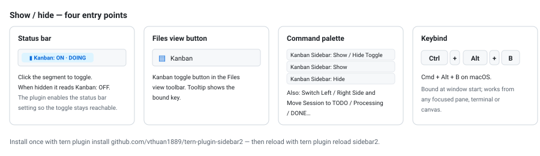
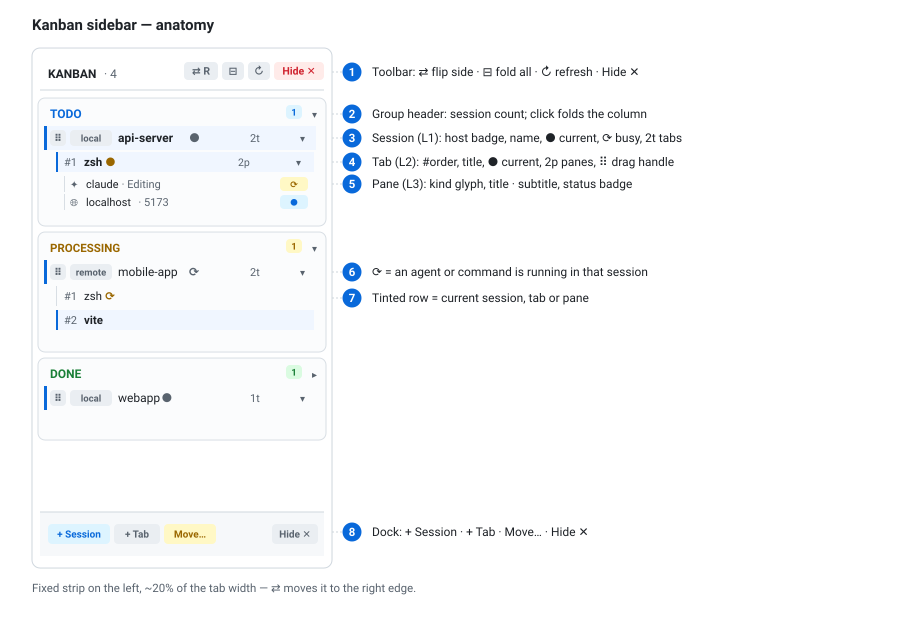
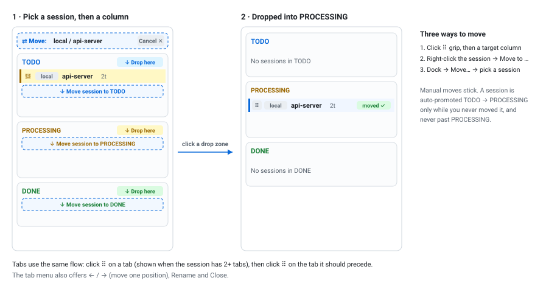

# Sidebar Kanban (`sidebar2`)

A fixed Kanban sidebar for Tern that turns your window layout into a board: every **Host + Session** lives
in one of three columns — **TODO**, **PROCESSING**, **DONE** — and you can drill into its **tabs** and
**panes** from the same strip.

The sidebar is a plugin canvas pinned to the edge of the active tab. It never takes focus, and the rest of
the tab is untouched.

- Three columns, three levels: session → tab → pane.
- Move sessions by grip-and-drop, row menu, or the `Move…` picker.
- Reorder tabs by grip-and-drop.
- Show/hide from the status bar, the Files button, the command palette or `Ctrl+Alt+B`.
- Layout, column assignment and fold state persist across restarts.

## Install

```sh
tern plugin install github.com/vthuan1889/tern-plugin-sidebar2
# or, while hacking on it:
git clone https://github.com/vthuan1889/tern-plugin-sidebar2 && cd tern-plugin-sidebar2
tern plugin link .
tern plugin reload sidebar2
```

`tern plugin list` shows whether it loaded. Type definitions for `luau-lsp` regenerate with
`tern plugin types .`.

## Show / hide



The toggle is reachable even when the sidebar is hidden — the plugin turns on the `status_bar` setting so
the segment is always there.

| Entry point | Where |
| --- | --- |
| Status bar | `Kanban: ON · <stage>` / `Kanban: OFF` segment, click to toggle |
| Files view | Kanban icon button in the Files toolbar |
| Command palette | `Kanban Sidebar: Show / Hide Toggle` |
| Keybind | `Ctrl+Alt+B` (`Cmd+Alt+B` on macOS) |

## Anatomy



| Level | Row | Shows | Click |
| --- | --- | --- | --- |
| — | Toolbar | session count, `⇄` flip side, `⊟` fold all, `↻` refresh, `Hide ✕` | acts immediately |
| 2 | Group header | `TODO` / `PROCESSING` / `DONE`, count badge, chevron | folds the column |
| 1 | Session | host badge, session name, `2t` = tab count, `●` current, `⟳` busy | switches to the session |
| 2 | Tab | `#order`, tab title, `2p` = pane count, `●` current, `⟳` busy | focuses the tab |
| 3 | Pane | kind glyph, pane title, `·` subtitle, status badge | focuses the pane |

Level 3 appears only for tabs holding **2 or more panes** — single-pane tabs stay compact.
Status badges: `!` error, `⟳` running, `●` focused, otherwise the pane kind.

Row tint plus the accent bar mark the current session, tab and pane. Long names are truncated at 20
characters (sessions) and 24 (tabs).

## Moving sessions between columns



Three equivalent ways, all stored per session:

1. **Grip-and-drop** — click the `⠿` grip on a session row. A banner appears, every column header turns
   into `↓ Drop here` and each column shows a `↓ Move session to …` target. Click one. `Cancel ✕` in the
   banner aborts instead.
2. **Row menu** — right-click the session row (or its grip): `Move to TODO`, `Move to Processing`,
   `Move to DONE`.
3. **`Move…` in the dock** — a picker listing every session × column, with the current column as detail.

The picked session shows `🎯` instead of `⠿`.

### Auto-promotion

A new session starts in **TODO**. The first time one of its commands or agents starts running, it is
promoted to **PROCESSING** on its own — but only while you have never moved that session manually. From
the first manual move on, the column is yours and the plugin stops touching it. Nothing is ever moved to
**DONE** automatically.

## Reordering tabs

Click `⠿` on a tab row (the grip appears when the session has **2 or more** tabs) → the tab turns `🎯`
and the header shows `↕ Move Tab: …`. Now click `⠿` on any other tab of the same session: the picked tab
is moved to that position. The tab menu also has `←` / `→` for one step at a time.

## Row menus

| Row | Menu items |
| --- | --- |
| Group header | Fold / unfold column · New session in *this column* |
| Session | Pick · Move to TODO · Move to Processing · Move to DONE · New tab here · Rename session |
| Tab | Focus · Pick *(2+ tabs)* · Move to previous position · Move to next position · Rename · Close tab |
| Pane | Focus · Split right · Split down · Close pane |

`Close tab` closes every non-sidebar pane in that tab. `+ Session` (dock) asks for a name — leave it
empty for an auto-generated one — and places the session in **TODO**.

## Placement

The strip is a canvas pane pinned to the left edge of the active tab at **20%** of its width; it follows
you when you switch sessions, tabs or hosts, one strip per host. `⇄` moves it to the right edge.

Width is fixed, not drag-resizable.

## Persistence

State is stored in the plugin's key/value store:

| Key | Contents |
| --- | --- |
| `host::session` | column assignment, keyed by **host name + session name** |
| session key | fold state, manual-move flag |
| `tab id` | fold state |
| — | visibility, side |

Because the column key includes the session **name**, renaming a session resets it to **TODO**.

## Commands

| Command | Does |
| --- | --- |
| `plugin.sidebar2.toggle` | show / hide (also bound to `Ctrl+Alt+B`, `Cmd+Alt+B`) |
| `plugin.sidebar2.show` | show |
| `plugin.sidebar2.hide` | hide |
| `plugin.sidebar2.flip_side` | switch left ↔ right edge |
| `plugin.sidebar2.move_session` | open the `Move…` picker |

## Troubleshooting

- Sidebar gone → click the `Kanban: OFF` status-bar segment, or `tern plugin reload sidebar2`.
- Two strips in one tab → the plugin cleans up stale canvases 2.5 s after a pane is created; use `↻`
  to force a re-render, or close the extra canvas like any pane.
- Plugin not listed → `tern plugin list`, then check `plugins_disabled` in Tern's settings.
- Uninstall: `tern plugin remove sidebar2` (or `tern plugin unlink sidebar2` for a linked checkout).

## Files

| File | Role |
| --- | --- |
| `plugin.toml` | manifest: entry window `window.luau`, stylesheet `sidebar.css` |
| `window.luau` | data collection, view, canvas actions, layout engine, commands |
| `sidebar.css` | scoped styles for `[data-role^="sidebar2."]` |
| `tern.d.luau` | generated type definitions for `luau-lsp` |
